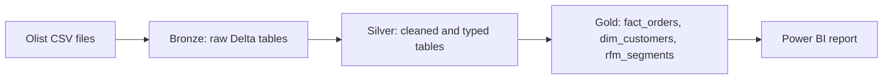
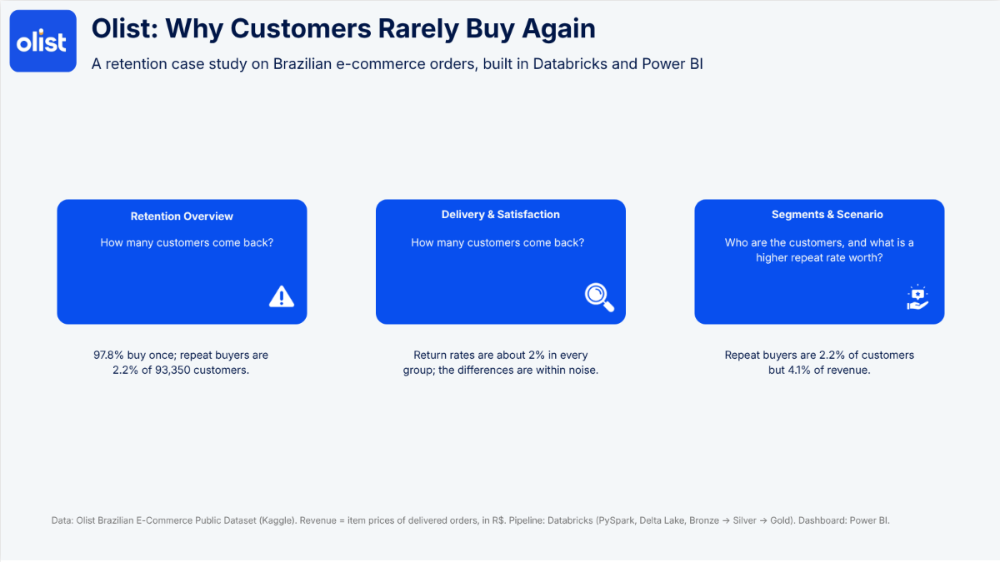
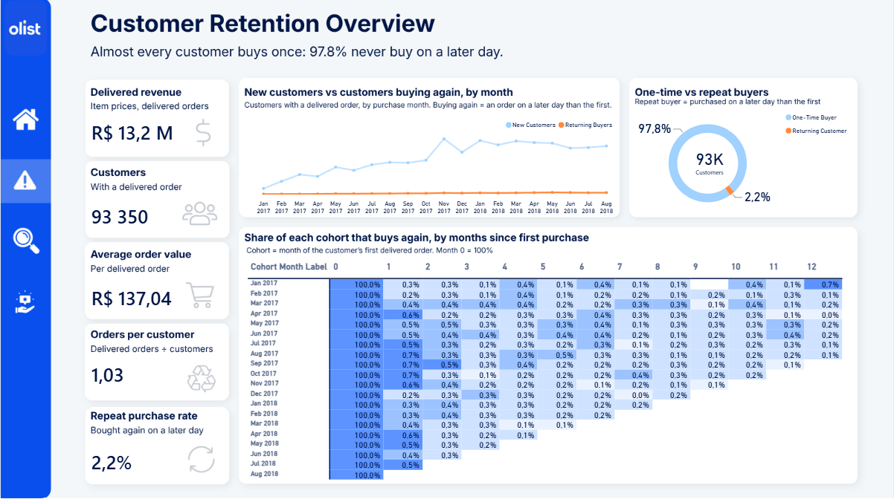
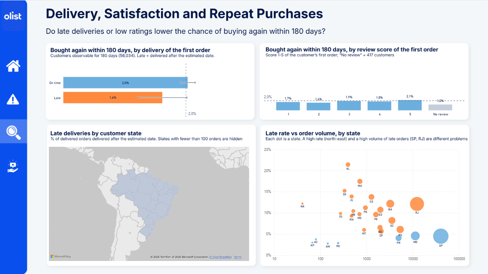
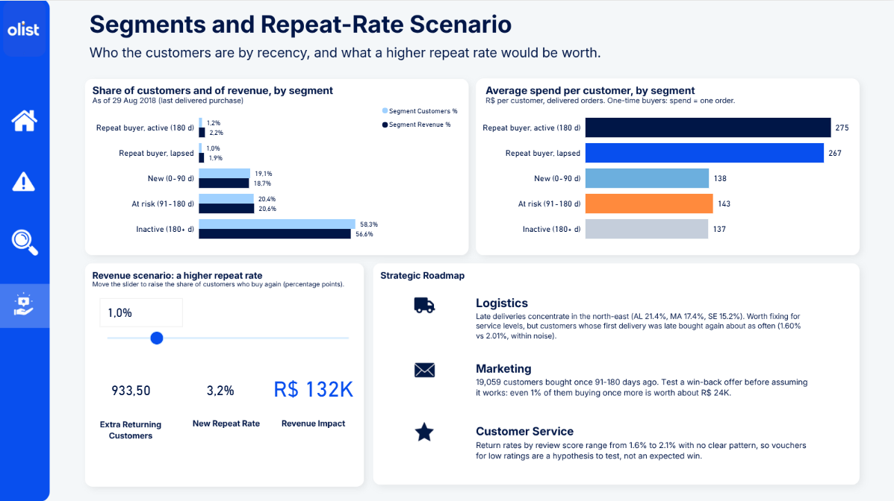

# Olist Customer Retention Analysis: Databricks Lakehouse and Power BI

## Project overview

This case study asks why customers of a Brazilian e-commerce marketplace rarely buy again, and what that is worth. I built a Medallion pipeline (Bronze, Silver, Gold) in Databricks, defined retention in a way that holds up to scrutiny, tested whether late deliveries and low review scores change repeat behaviour, and presented the results in a Power BI report.

The analysis covers:

- **99,433 orders** (96,470 delivered; delivered purchases from **15 September 2016 to 29 August 2018**),
- **93,350 customers** with a delivered order,
- **R$ 13.2M** of item revenue from delivered orders.

**Technologies:** Databricks (Apache Spark, PySpark, Spark SQL), Delta Lake, Unity Catalog, Power BI (DAX), Canva (report background)

**Data engineering techniques:**

- Medallion architecture with Delta tables,
- type conversion, text normalisation and integrity rules in Silver,
- pre-aggregation before joins to control the grain of fact tables,
- window functions (`row_number`, `percentile_approx`),
- reconciliation queries for every figure used in the report.

**Analytics and Power BI techniques:**

- retention defined on customers and time windows,
- cohort retention matrix,
- two-proportion z-test and confidence intervals (error bars),
- rule-based RFM segmentation with thresholds taken from the data,
- DAX measures, a what-if parameter for a revenue scenario, conditional formatting.

## Business questions

1. How many customers come back, and how long do they take?
2. Do late deliveries or low review scores change the chance of buying again?
3. Which customer segments exist, and what would a higher repeat rate be worth?

## Architecture



| Layer | Tables | Purpose |
|-------|--------|---------|
| Bronze | one table per CSV file | Raw ingestion, no changes |
| Silver | orders, customers, order items, order reviews, payments, products, category translation | Schema enforcement, cleaning, integrity rules |
| Gold | `fact_orders`, `dim_customers`, `rfm_segments` | Analysis-ready tables used by the report |

Silver tables for payments, products and category translation are prepared for further analysis (for example category-level retention) but are not used in the current report. `Gold_Fact_Sales.py` and `Gold_Dim_Products.py` are the first version of the Gold layer; they are kept for reference and superseded by `Gold_Fact_Orders.py` (see the table below).

## Data preparation and quality checks

Six data-quality notebooks (`00_Data_Quality_Check_*.py`) inspect the source tables before transformation. Further reconciliation queries are collected in `Validation_Queries.sql`, with the expected result next to each query.

The review of the first version of the pipeline led to these corrections:

| First version | Problem | Final version |
|---------------|---------|---------------|
| RFM frequency counted rows of the item-level fact table | Inflated frequency for **9,649 of 95,412** customers (10.1%) | Distinct delivered orders and distinct purchase days |
| "Returning customer" = more than one order | **786 of the 2,801** customers with two or more delivered orders placed all of them on a single day | Returning = bought on a **later day** than the first purchase (2,015 customers, 2.16%) |
| "Churn" = share of fact-table rows of one-time buyers (96.9%, 94.5% for late deliveries) | Unit was rows, not customers; no time window; undelivered orders included | **180-day return rate** of customers observable for 180 days, split by the **first** order |
| Late flag compared timestamps | 1,450 of 8,715 flagged rows were deliveries on the estimated day (16.6%) | Day-level comparison, `NULL` for undelivered orders; 6,534 late orders (6.8%) |
| Item-level fact with an inner join to order items | Lost **775 orders** and **684 customers** (order without items, mostly canceled or unavailable) | Order-level fact: items and reviews aggregated first, then joined |
| Revenue included all order statuses | R$ 370,145.59 (2.7%) came from orders that were not delivered | Delivered revenue **R$ 13,220,248.93** |
| Hard-coded reference date `2018-10-31` | 63 days after the last delivered purchase | Reference date derived from the data (2018-08-29) |
| "Uplift" = revenue × slider | Not linked to retention | Scenario: extra returning customers × spend of today's returning customers |
| "At Risk" segment | Unreachable branch in the code, never assigned | Rule-based segments with documented thresholds |

Checks that passed: the order-level fact has one row per order (99,433 rows, 99,433 orders); item revenue in the fact table equals item revenue in Silver (R$ 13,590,394.52); the only orders removed in Silver are 8 delivered orders without a delivery date (8 items, R$ 1,249.18).

## Key findings

### 1. Almost nobody buys again

Of 93,350 customers, **2,015 (2.16%) bought on a later day** than their first purchase; 97.8% did not. Of the 2,801 customers with two or more delivered orders, 786 placed all of them on one day, so counting orders instead of days would overstate retention by about 39%.

Among customers who do return, the first later purchase comes after a median of **74 days** (25th percentile 23, 75th percentile 175, 90th percentile 288). These figures are cut off by the end of the data and understate the real gaps.

Using the 180-day window on customers observable for that long (56,034, which is 60%), **1,109 customers (1.98%) returned within 180 days**.

### 2. Delivery and satisfaction hardly change repeat behaviour

| First order | Customers | Returned within 180 days | Rate |
|-------------|----------:|-------------------------:|-----:|
| Delivered on time | 52,215 | 1,048 | 2.01% |
| Delivered late    | 3,819  | 61    | 1.60% |

The gap of 0.4 percentage points is within sampling noise (z = 1.76, p about 0.08).

| Review score of the first order | Customers | Returned | Rate |
|---------------------------------|----------:|---------:|-----:|
| 1 | 5,610  | 96  | 1.71% |
| 2 | 1,781  | 28  | 1.57% |
| 3 | 4,861  | 94  | 1.93% |
| 4 | 11,157 | 205 | 1.84% |
| 5 | 32,208 | 681 | 2.11% |
| No review | 417 | 5 | 1.20% |

Rates range from 1.6% to 2.1% with no clear pattern. Late deliveries are, however, a regional problem: **6,534 of 96,470 delivered orders (6.8%)** arrived late, with the highest rates in the north-east (AL 21.4%, MA 17.4%, SE 15.2%, PI 13.9%, CE 13.8%). São Paulo and Rio de Janeiro have low rates but hold **3,315 of the 6,534 late orders (51%)** because of their volume.

### 3. Segments and a revenue scenario

| Segment | Customers | Share | Revenue (R$) | Share of revenue | Average spend (R$) |
|---------|----------:|------:|-------------:|-----------------:|-------------------:|
| Repeat buyer, active (180 d) | 1,076  | 1.15%  | 295,866.60   | 2.24%  | 275 |
| Repeat buyer, lapsed         | 939    | 1.01%  | 250,769.95   | 1.90%  | 267 |
| New (0-90 d)                 | 17,836 | 19.11% | 2,466,833.97 | 18.66% | 138 |
| At risk (91-180 d)           | 19,059 | 20.42% | 2,722,688.79 | 20.59% | 143 |
| Inactive (180+ d)            | 54,440 | 58.32% | 7,484,089.62 | 56.61% | 137 |

Segments are rule-based and as of 29 August 2018. In `rfm_segments` the repeat buyers are stored as "Loyal - active" and "Loyal - lapsed". Repeat buyers are 2.16% of customers and 4.14% of revenue, with about twice the average spend.

**Scenario:** each returning customer spends R$ 141.25 on orders placed on later days (2,015 customers, 2,260 later-day orders, R$ 284,625.92, average later-day order R$ 125.94). Raising the repeat rate by **1 percentage point** means 934 additional returning customers, worth about **R$ 131,900**; 5 percentage points would be worth about R$ 659,000. One point is already a 46% relative increase over today's 2.16%, and it equals 4.9% of the "At risk" segment, so the scenario is ambitious. It is a what-if calculation, not a forecast.

## Power BI dashboard

| Page | Content |
|------|---------|
| Home | Project summary, headline finding, navigation |
| Retention Overview | KPIs, new vs returning customers by month, one-time vs repeat buyers, cohort retention matrix |
| Delivery & Satisfaction | 180-day return rate by delivery of the first order (with confidence intervals) and by review score, late deliveries by state, late rate vs volume |
| Segments & Scenario | Customers and revenue by segment, average spend, repeat-rate scenario, takeaways |






Design decisions:

- Percentages come with the number of customers behind them (tooltips); the delivery chart adds confidence intervals.
- The map hides states with fewer than 100 delivered orders.
- One accent colour (orange) marks only what the page is about: customers who come back, late deliveries, the "At risk" segment.
- Every number in the report was reconciled with the queries in `Validation_Queries.sql`.

## Recommendations

1. **Treat retention as the main growth question.** 97.8% of customers never buy on a later day, and the repeat rate is about 2% in every group examined.
2. **Fix north-east delivery for service reasons, not for retention.** The late rate is high there (up to 21.4%), but customers whose first delivery was late did not return detectably less often.
3. **Test win-back offers before assuming they work.** The "At risk" segment (19,059 customers, 91-180 days after one purchase) is still inside the window in which repeat purchases happen. Split into two groups of about 9,500, an experiment could only detect an increase of roughly 0.6 percentage points.
4. **Do not rely on review scores alone as a retention lever.** The rate for score 1 (1.71%) and score 5 (2.11%) differs by 0.4 points, and the pattern is not monotonic.
5. **Extend the analysis to the category of the first purchase.** The Silver tables for products and category translation are ready for it.

## Analytical assumptions and limitations

- **Two years of data.** Customers who first bought late in the period had little time to return, so return gaps are understated and the 180-day analysis covers only 60% of customers.
- **Small effects.** About 2% of customers return in every group, so differences of a few tenths of a percentage point are hard to separate from chance.
- **Association, not causation.** Late deliveries and low ratings are not randomly assigned.
- **Customer identity.** Customers are identified by `customer_unique_id`; purchases made under a different identity cannot be linked.
- **Review score of the first order** is the average when an order has several reviews.
- **Segment thresholds** (90 and 180 days) were chosen from the observed return gaps, which are themselves censored.
- **Revenue** is the sum of item prices of delivered orders (freight excluded), in reais according to community documentation of the dataset.
- **Scenario assumptions:** extra returning customers spend like today's returning customers, and revenue is not profit.
- **Historical data** from 2016 to 2018.

## Repository structure

```
olist-customer-retention-databricks-powerbi/
├── README.md
├── Validation_Queries.sql
├── Ingest_CSV_to_Bronze.py
├── 00_Data_Quality_Check_Customers.py
├── 00_Data_Quality_Check_OrderItems.py
├── 00_Data_Quality_Check_Orders.py
├── 00_Data_Quality_Check_Payments.py
├── 00_Data_Quality_Check_Products.py
├── 00_Data_Quality_Check_order_reviews.py
├── Transform_category_translation_silver.py
├── Transform_Customers_Silver.py
├── Transform_OrderItems_Silver.py
├── Transform_Orders_Silver.py
├── Transform_Payments_Silver.py
├── Transform_Products_Silver.py
├── Transform_Reviews_Silver.py
├── Gold_Fact_Orders.py          (order-level fact table)
├── Gold_Dim_Customers.py        (customer dimension with return flags)
├── Gold_RFM_Segmentation.py     (rule-based segments)
├── Gold_Fact_Sales.py           (first version, superseded)
├── Gold_Dim_Products.py         (first version, not used by the report)
├── Olist_Retention.pbix
├── dashboard_home.png
├── dashboard_retention.png
├── dashboard_delivery.png
└── dashboard_segments.png
```

## How to run

1. Create the catalog `olist_project` with the schemas `bronze`, `silver` and `gold`, and a Unity Catalog volume for the CSV files.
2. Download the Olist dataset (see below), upload the CSV files to the volume and run `Ingest_CSV_to_Bronze.py`.
3. Run the `Transform_*_Silver.py` notebooks.
4. Run the Gold notebooks in this order: `Gold_Fact_Orders.py`, `Gold_Dim_Customers.py`, `Gold_RFM_Segmentation.py`.
5. Run the queries in `Validation_Queries.sql` and compare with the expected values.
6. Open `Olist_Retention.pbix`. The file contains imported data, so it opens without a connection; to refresh, point the data source to your SQL warehouse (server hostname and HTTP path).

## Data source

Olist, Brazilian E-Commerce Public Dataset (Kaggle). The source data is not included in this repository; please check the terms of use of the source before redistributing it.
